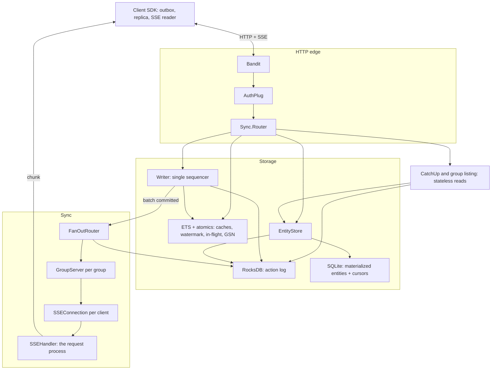
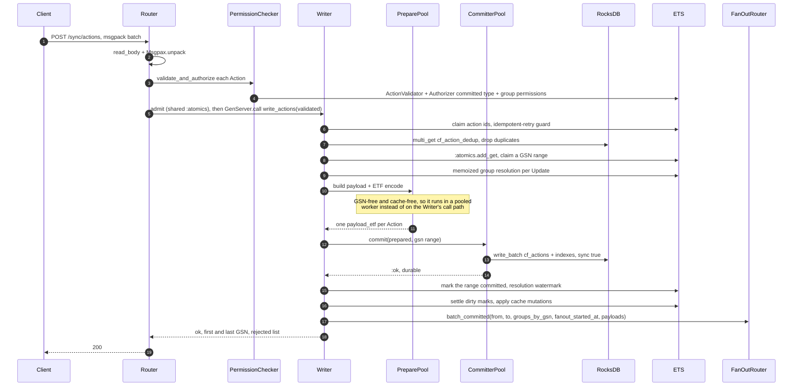
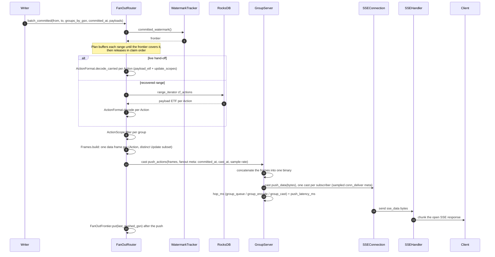
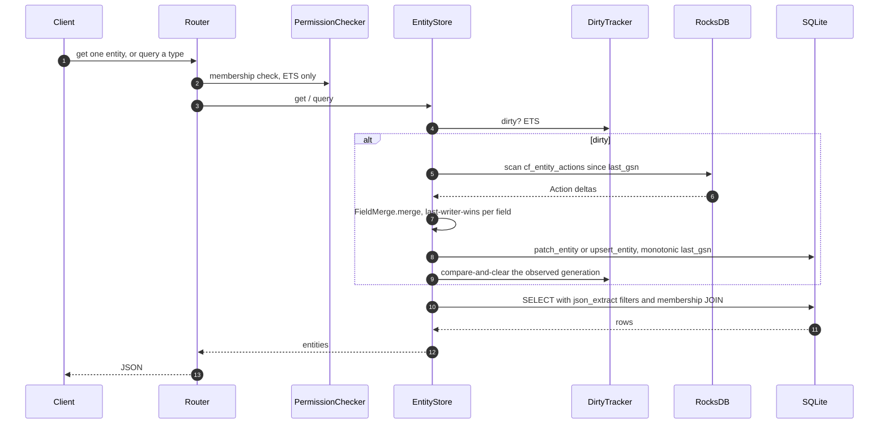
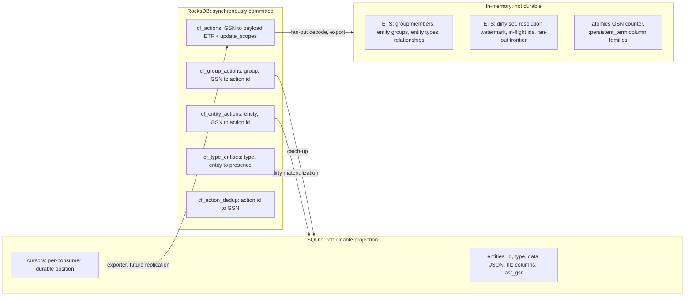
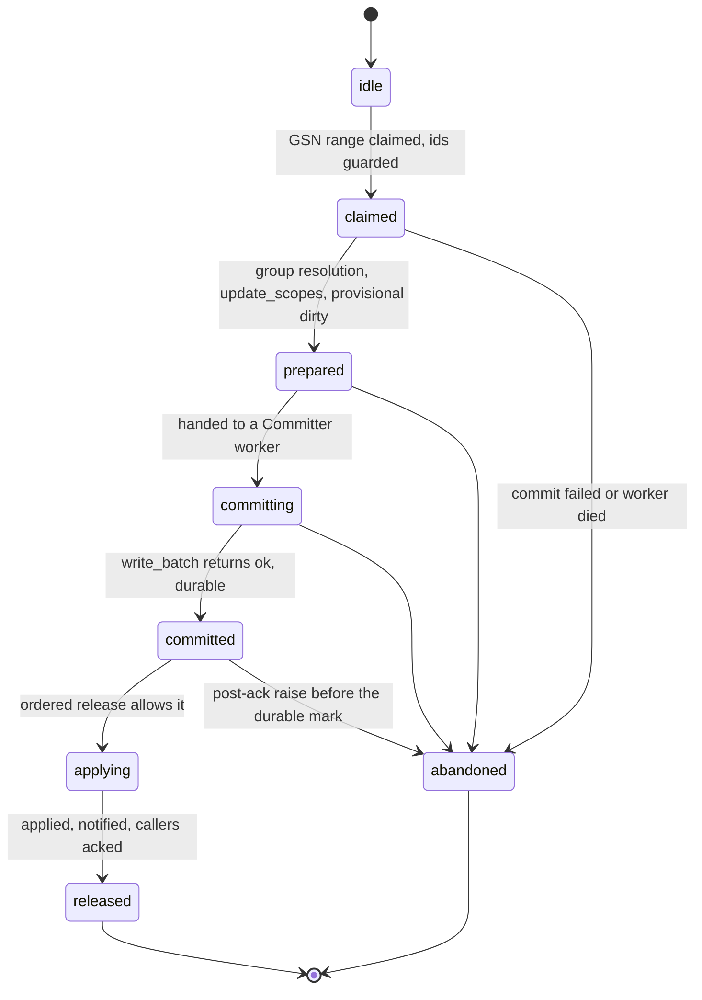

# Ebb Server

Elixir/OTP backend for the ebb local-first collaborative platform.
Handles persistent storage, sync protocol, real-time fan-out,
permission enforcement, and HTTP API.

## Quick Start

```bash
# Install dependencies
mix deps.get

# Run tests
mix test

# Start dev server (http://localhost:4000) with lib/ auto-reload
mix dev
```

`mix dev` runs the application under `MIX_ENV=dev`. There is no file
watcher — restart with `mix dev` after editing anything under `lib/`
or `config/`.

From the repo root, `pnpm dev:collab` runs `mix dev` plus the
`collaborative-text-demo` Vite app in the same terminal pane.

## Code Quality

```bash
# Format code
mix format

# Check formatting
mix format --check-formatted

# Run credo linter
mix credo --strict

# Run tests
mix test

# Run tests with coverage (CI gates the printed total)
mix test --cover
```

Coverage counts the server's own modules minus a short documented ignore
list, and is gated at 89% — see
[docs/tooling/ebb-server-coverage.md](../docs/tooling/ebb-server-coverage.md)
for what is ignored and why.

## OpenAPI Spec

The HTTP API is documented with an OpenAPI 3.1 spec.

```bash
# Generate openapi.yaml from router annotations
mix openapi.gen.spec
```

## Configuration

| Variable        | Default           | Description                                                              |
| --------------- | ----------------- | ------------------------------------------------------------------------ |
| `EBB_PORT`      | `4000`            | HTTP listen port                                                         |
| `EBB_DATA_DIR`  | `/app/data`       | RocksDB + SQLite data directory                                          |
| `EBB_AUTH_MODE` | (none — required) | Auth mode: `bypass` or `external`. The node refuses to boot without one. |
| `EBB_AUTH_URL`  | (none)            | Identity service URL. Required when `EBB_AUTH_MODE=external`.            |

Auth is the one setting whose precedence is reversed: `EBB_AUTH_MODE` and
`EBB_AUTH_URL` win over the compiled `:auth_mode` / `:auth_url` values,
because the operator's runtime instruction must not be silently
overridden by a release's baked-in config. There is deliberately no
default mode — a bare `mix release` boot without auth configuration
fails before any child starts rather than silently allowing every client
to forge an actor identity. `:bypass` logs a warning at boot and must
never be exposed publicly.

`EBB_PORT` and `EBB_DATA_DIR` keep the opposite precedence: a compiled
`:port` / `:data_dir` (what `MIX_ENV=test` uses) wins over the
environment, so a test run cannot leak state into a deployment path or a
port another service holds. `mix dev` and the release leave both unset,
so the environment supplies them there.

## Self-hosting in Docker

The image in `ebb_server/Dockerfile` assembles the release in a builder
stage and runs it from `debian:bookworm-slim` as a non-root user, with
`GET /healthz` backing the container healthcheck and `/app/data` as the
volume. `EBB_AUTH_MODE` must be set explicitly; the container refuses to
boot otherwise.

```bash
docker build -f ebb_server/Dockerfile -t ebb_server:local .   # repo root
docker run -d -p 4000:4000 -v ebb-data:/app/data \
  -e EBB_AUTH_MODE=external -e EBB_AUTH_URL=https://identity.example.com \
  ebb_server:local
```

See [`docs/self-hosting.md`](../docs/self-hosting.md) for compose
profiles, persistence, upgrades, and backups, and
[`scripts/docker-smoke-test.sh`](../scripts/docker-smoke-test.sh) for the
container acceptance checks CI runs on every pull request.

## Architecture

The Elixir server is the system of record. It owns all persistent
storage, the sync protocol, real-time fan-out, permission enforcement,
and the HTTP API that both browser clients and (eventually) the Bun
Application Server use to read and write data.

### Storage architecture

A dual-store CQRS pattern:

- **RocksDB** (LSM-tree, the `rocksdb` Erlang NIF) holds the Action log
  — the source of truth. Every committed Action goes through
  `EbbServer.Storage.Writer` and is durable on disk before its GSN is
  returned to the caller.
- **SQLite** (B-tree, via `exqlite`) serves as the read-optimized
  materialized entity cache. Entity state is materialized on demand by
  `EbbServer.Storage.EntityStore` when reads request dirty entities —
  never eagerly on every write.

Dirty marks are in-memory, so a restart makes every not-yet-materialized
row look clean. The boot rebuild repairs that: it re-marks every
`cf_type_entities` row dirty, so the first `get` or per-type `query`
replays that row's delta from RocksDB. The eagerly materialized system
types (`groupMember`, `entityGroup`, `relationship`) clear their marks
during boot; `group` and user types stay marked until first read
([#564](https://github.com/ebbjs/ebbjs/issues/564)). The replay reads the
entity's `cf_entity_actions` tail, so it repairs a row only while the log
still retains the delta above that row's `last_gsn`; action-log retention
is [#123](https://github.com/ebbjs/ebbjs/issues/123)'s horizon.

`enable_pipelined_write: true` is set on the RocksDB instance. The
historical ~108k Actions/sec figure is a 2-writer, raw-RocksDB primitive
(see [#130](https://github.com/ebbjs/ebbjs/issues/130)); measured through
the real server, the production single-Writer configuration sustains
**~15k Actions/sec** (`sync: true`, 2-Update Actions). Writer batch
coalescing ([#332](https://github.com/ebbjs/ebbjs/issues/332)) leaves that
batch-100 rate flat — it is per-Action-bound — and roughly triples batch-1
direct-write throughput; see
[`bench/RESULTS.md`](bench/RESULTS.md). Production runs a single Writer,
and a second claim owner is parked rather than scheduled: multi-Writer
pipelining sits in [epic #529](https://github.com/ebbjs/ebbjs/issues/529),
where [#287](https://github.com/ebbjs/ebbjs/issues/287) records the
claim-ownership and orphan-vs-in-flight reconcile work it would need.
`enable_pipelined_write: true` is dormant in production: at the default
`:writer_max_in_flight` of 1 the Writer never issues two batches
concurrently.

### Module map

| Module                                                                           | Purpose                                                                                 |
| -------------------------------------------------------------------------------- | --------------------------------------------------------------------------------------- |
| `EbbServer.Storage.RocksDB`                                                      | DB lifecycle, column families, key encoding, low-level I/O                              |
| `EbbServer.Storage.SQLite`                                                       | Entity cache: schema DDL, UPSERT, filtered query with permissions                       |
| `EbbServer.Storage.SystemCache` (sup.)                                           | ETS + `:atomics` for GSN, watermark, dirty set, group/relationship                      |
| `EbbServer.Storage.Writer`                                                       | Imperative shell: coalescing, GSN claim, group resolution, apply/notify                 |
| `EbbServer.Storage.PreparePool`                                                  | Supervised prepare workers: GSN-free payload build and ETF encode off the call path     |
| `EbbServer.Storage.Preparer`                                                     | One prepare worker: `ActionFormat` build + encode, crash-contained per job              |
| `EbbServer.Storage.CommitPipeline`                                               | Pure pipeline state machine: pending calls, claim order, in-flight guard, release order |
| `EbbServer.Storage.CacheMutationPlanner`                                         | Pure cache-write planner: per-flush dedup and the row overlay chained plans share       |
| `EbbServer.Storage.Committer`                                                    | Durable half of a flush: wrapper encode, op assembly, `write_batch`                     |
| `EbbServer.Storage.CommitterPool`                                                | Supervised Committer workers, one job per worker, crash-to-failed-range reporting       |
| `EbbServer.Storage.PreparedAction`                                               | Immutable sequencer → committer boundary payload                                        |
| `EbbServer.Storage.ActionLog`                                                    | Committed-log reader: decodes an inclusive GSN range in order                           |
| `EbbServer.Storage.ActionFormat`                                                 | `cf_actions` value shape: GSN-free payload, scopes wrapper, dual-shape decode           |
| `EbbServer.ActionExport` (opt-in)                                                | Polls the committed log and invokes the `:on_action` handler                            |
| `EbbServer.Storage.EntityStore`                                                  | Read API with on-demand materialization                                                 |
| `EbbServer.Storage.PermissionChecker`                                            | Action validation, per-Update + read-side permission decisions                          |
| `EbbServer.Storage.WatermarkTracker`                                             | Resolution-frontier ETS + `:atomics` (SSE fan-out gating)                               |
| `EbbServer.Storage.InFlightActions`                                              | In-flight action-id ETS (idempotent-retry concurrency guard)                            |
| `EbbServer.Storage.{DirtyTracker,GroupCache,EntityGroupCache,RelationshipCache}` | In-memory state children of `SystemCache`                                               |
| `EbbServer.Storage.GsnCounter`                                                   | Lock-free GSN claiming + restart reconcile (`:atomics`)                                 |
| `EbbServer.Telemetry.Sampler`                                                    | Periodic watermark / dirty-set / in-flight / fan-out gauges                             |
| `EbbServer.Sync.AuthPlug`                                                        | Actor identity extraction (bypass + external modes)                                     |
| `EbbServer.Sync.Router`                                                          | HTTP plug router                                                                        |
| `EbbServer.Sync.CatchUp`                                                         | Paginated catch-up                                                                      |
| `EbbServer.Sync.GroupListing`                                                    | Group-scoped cold-bootstrap entity listing                                              |
| `EbbServer.Sync.SSEHandler`                                                      | The SSE wire format                                                                     |
| `EbbServer.Sync.FanOutRouter`                                                    | Watermark-gated routing to per-group `GroupServer`                                      |
| `EbbServer.Sync.FanOutFrontier`                                                  | Last-pushed GSN persisted across a Router restart                                       |
| `EbbServer.Sync.GroupServer`                                                     | Per-group fan-out; holds subscribers' senders                                           |
| `EbbServer.Sync.SSEConnection`                                                   | Per-live-subscription pid; receives pushes via its `GroupServer`                        |

Each module's `@moduledoc` documents the load-bearing decisions and the
hot-path behavior. Read those before making non-trivial changes.

### HTTP endpoint table

| Method | Path                                             | Purpose                                                                |
| ------ | ------------------------------------------------ | ---------------------------------------------------------------------- |
| `GET`  | `/healthz`                                       | Readiness probe (`200` ready / `503` not ready), no auth required      |
| `POST` | `/sync/handshake`                                | Actor identity + group membership (requires `x-ebb-actor-id` header)   |
| `GET`  | `/sync/groups/:group_id?offset=N`                | Paginated catch-up (`stream-next-offset`, `stream-up-to-date` headers) |
| `GET`  | `/sync/groups/:group_id/entities?cursor=&limit=` | Group state at a watermark, for cold bootstrap                         |
| `GET`  | `/sync/live?groups=...&cursor=N`                 | SSE stream of new actions                                              |
| `POST` | `/sync/actions`                                  | Write actions (MessagePack body)                                       |
| `POST` | `/sync/presence`                                 | Broadcast ephemeral presence data on an entity                         |
| `GET`  | `/entities/:id`                                  | Materialized entity (requires `actor_id` query param or header)        |
| `POST` | `/entities/query`                                | Query entities by type with optional filter/limit/offset               |

The OpenAPI 3.1 spec is generated from router annotations via
`mix openapi.gen.spec` and lives at `ebb_server/openapi.yaml`.

### Supervision tree

```
EbbServer.Supervisor (one_for_one)
├── Storage Supervisor (rest_for_one)
│   ├── Storage.RocksDB                    — opens DB, creates column families
│   ├── Storage.SQLite                     — opens DB, runs DDL
│   ├── Storage.SystemCache                — creates ETS tables, populates from RocksDB
│   │   ├── Storage.DirtyTracker
│   │   ├── Storage.GroupCache
│   │   ├── Storage.EntityGroupCache
│   │   └── Storage.RelationshipCache
│   ├── Storage.WatermarkTracker           — resolution-frontier ETS + :atomics
│   ├── Storage.InFlightActions            — in-flight action-id ETS
│   └── Storage.Writer                     — imperative shell: claim, resolve, apply
│       ├── Storage.PreparePool             — supervised prepare workers; owns no ordering
│       │   ├── DynamicSupervisor
│       │   └── Storage.Preparer × N        — GSN-free payload build + ETF encode
│       ├── Storage.CommitPipeline         — pure pending/claim/release ordering state machine
│       ├── Storage.CacheMutationPlanner   — pure cache-write planner: dedup + row overlay
│       └── Storage.CommitterPool           — supervised workers; contains a worker death per range
│           ├── DynamicSupervisor
│           └── Storage.Committer × N       — wrapper encode + op assembly + durable write
├── Telemetry.Sampler                      — 1 Hz watermark / dirty-set / in-flight / fan-out gauges
├── Sync Supervisor (one_for_one)
│   ├── Sync.FanOutFrontier                — persisted last-pushed frontier
│   ├── Sync.FanOutRouter
│   ├── Sync.GroupDynamicSupervisor (per-group GroupServers)
│   └── Sync.SSEConnectionSupervisor (per-live-connection pids)
├── Bandit HTTP listener, plug: Sync.Router
└── ActionExport.Supervisor (opt-in, only when `:on_action` is set)
    ├── ActionExport.TaskSupervisor     — bounded handler invocations
    └── ActionExport                    — durable cursor + poll loop
```

`Storage.Writer` is deliberately the **last** child of the `rest_for_one`
Storage supervisor. A `SystemCache` (or `WatermarkTracker`) failure therefore
rebuilds the caches, the watermark, and the in-flight action-id set and
restarts the Writer, which reconciles against the fresh frontier on `init/1`;
a Writer-only crash restarts the Writer and its linked Committer pool
together, and the replacement Writer clears the stale in-flight ids and
reconciles the orphaned tail on `init/1`. An individual Committer death is
contained inside the pool: the Writer survives, that worker's range is
abandoned and resolved, and the other in-flight ranges keep committing. A
worker already inside `write_batch` may finish after the pool shuts down;
GSNs are never reused, so that late write can only fill a range already
reported as a hole. Any RocksDB crash still restarts the whole storage tree
in order, because SystemCache populates from RocksDB on init and the Writer
coordinates through cache state.

### Data flow

The supervision tree is the static shape; these are the paths that run on
it. Every diagram is the current code, not a target.

#### Request topology



#### Write path (`POST /sync/actions`)



#### Fan-out path (committed range to SSE client)



#### Read path (`GET /entities/:id`, `POST /entities/query`)



A `query` materializes every dirty entity of the requested type before
it runs, so one stale row costs the whole query.

#### Storage layout



#### Batch lifecycle



`claim_order` is the reorder buffer: a batch may not apply or notify until
every earlier range is released or abandoned. Holes are permanent, because
GSNs are never reused, which is why the watermark is a _resolution_
frontier rather than a contiguous-commit one.

A commit older than `:writer_commit_timeout_ms` is retired by the
Committer-pool watchdog: the Writer abandons exactly that range, emits
`ebb.writer.commit_timeout`, and callers receive
`{:error, {:rocksdb_write_failed, :commit_timeout}}` → `503 write_failed`.
The worker is retired and replaced without waiting for the stuck NIF, so the
frontier and the other in-flight ranges keep moving. The late write may
still land; GSNs are never reused, so it can only fill the already-resolved
hole. Because the Writer must stay responsive for the watchdog to run, a
Writer with the watchdog enabled commits in the pool even at depth 1; the
inline commit path is used only when `:writer_commit_timeout_ms` is `0`.

Calls are admitted before the Writer's mailbox. Above
`:writer_max_pending_calls` (default 256) a new call is rejected with
`{:error, {:overloaded, retry_after_ms}}` → `429` + `Retry-After`, so a
saturated Writer cannot turn its mailbox into the queue. The first-party
client's own backoff (1 s → 60 s) dominates `Retry-After`; the header is for
third-party clients.

Each Action is capped at 1 MiB encoded and 1 000 Updates before
authorization and before it can claim a GSN. Over-cap Actions are returned in
`rejected[]` (`action_too_large` / `too_many_updates`) on a `200`, not as a
`4xx`: a non-2xx would be retried as `unreachable` by the client and would
head-of-line block every other pending write in the same flush.

**What these paths make visible.**

- **Two serialization points, not one.** The Writer is the documented
  one. The `SQLite` GenServer is the other, and it sits on every entity
  read.
- **The committed log is read back on three paths** — fan-out recovery
  (`cf_actions`), dirty materialization (`cf_entity_actions`), and
  catch-up or export (`cf_group_actions`, `cf_actions`). Live fan-out
  decodes the payloads carried with the Writer's notify instead.
- **Live SSE does not replay from the client cursor.** `SSEHandler`
  passes the cursor to `SSEConnection`, where it is stored but not used
  to replay; the router only rejects a cursor _ahead_ of the watermark.
  Gap-filling is the client's HTTP catch-up before it opens the stream,
  and the `control` event re-triggers it on reconnect.
- **Presence bypasses the log entirely.** `POST /sync/presence` casts to
  `FanOutRouter` and on to the `GroupServer`, so it has no durability or
  ordering story beyond the cast order.

## Cross-cutting concerns

### Serialization formats

| Layer                  | Format            | Library                                 |
| ---------------------- | ----------------- | --------------------------------------- |
| Client ↔ Server (wire) | MessagePack       | `Msgpax`                                |
| RocksDB (storage)      | ETF (Erlang Term) | `:erlang.term_to_binary/binary_to_term` |
| SQLite (entity cache)  | JSON              | `Jason`                                 |

**Every** component reading from RocksDB uses `binary_to_term(binary, [:safe])`
to prevent atom-table pollution. Stored map keys should be strings,
not atoms.

### Configuration

All runtime configuration flows through `Application.get_env(:ebb_server, key)`:

| Key                          | Description                                                                                                    | Default    |
| ---------------------------- | -------------------------------------------------------------------------------------------------------------- | ---------- |
| `:port`                      | HTTP listen port                                                                                               | 4000       |
| `:data_dir`                  | Directory for RocksDB + SQLite files                                                                           | `./data`   |
| `:auth_mode`                 | Auth mode (`:bypass` / `:external`); `EBB_AUTH_MODE` overrides it                                              | (none)     |
| `:auth_url`                  | Developer's auth endpoint URL; `EBB_AUTH_URL` overrides it; required for `:external`                           | (required) |
| `:writer_batch_max_size`     | Buffered Actions before an immediate commit (`<= 0` = no trigger)                                              | 1000       |
| `:writer_batch_timeout_ms`   | Coalescing window (`0` = burst-drain, no timer)                                                                | 0          |
| `:writer_max_in_flight`      | Claimed ranges the pipeline may hold at once (1–4); higher overlap needs the overlay chain                     | 1          |
| `:writer_prepare_pool_size`  | Prepare workers for payload build and ETF encode                                                               | 2          |
| `:writer_prepare_queue_max`  | In-flight prepare calls before the Writer rejects with `503 write_failed`                                      | 1024       |
| `:writer_prepare_timeout_ms` | Upper bound on one prepare job before it fails the call                                                        | 2000       |
| `:writer_commit_timeout_ms`  | A commit older than this is retired by the watchdog; `EBB_WRITER_COMMIT_TIMEOUT_MS` overrides when unset       | 2000       |
| `:writer_max_pending_calls`  | Calls admitted before new calls get `429` + `Retry-After`; `EBB_WRITER_MAX_PENDING_CALLS` overrides when unset | 256        |
| `:on_action`                 | Opt-in Action exporter handler (see [Action export](#action-export-the-onaction-hook))                         | (unset)    |

The periodic metric sampler is configured under its own key,
`Application.get_env(:ebb_server, EbbServer.Telemetry.Sampler)`:

| Sampler key              | Description                                         | Default                                  |
| ------------------------ | --------------------------------------------------- | ---------------------------------------- |
| `:enabled`               | Emit the periodic gauges                            | `true` (`false` in `MIX_ENV=test`)       |
| `:interval_ms`           | Sampling interval in milliseconds                   | `1000`                                   |
| `:rocks_name`            | RocksDB instance to read `max_gsn` from             | `EbbServer.Storage.RocksDB`              |
| `:watermark_tracker`     | WatermarkTracker instance to read the frontier from | `EbbServer.Storage.WatermarkTracker`     |
| `:dirty_set`             | Dirty-set ETS table name                            | resolved from `DirtyTracker`             |
| `:in_flight_actions`     | In-flight action-id tracker to read the size from   | `EbbServer.Storage.InFlightActions`      |
| `:connection_supervisor` | Supervisor to count active SSE connections from     | `EbbServer.Sync.SSEConnectionSupervisor` |
| `:group_supervisor`      | Supervisor to count active groups from              | `EbbServer.Sync.GroupDynamicSupervisor`  |

The HTTP request-metric translator is configured under its own key,
`Application.get_env(:ebb_server, EbbServer.Telemetry.HTTP)`:

| HTTP key   | Description                               | Default |
| ---------- | ----------------------------------------- | ------- |
| `:enabled` | Attach the Bandit request-span translator | `true`  |

Several keys that appeared in earlier docs — `:writer_count`, `:warmer_*`,
and `:replication_peers` — are **read by nothing in `lib/` or `config/`**.
Production runs a single `EbbServer.Storage.Writer` GenServer with batch
coalescing controlled by the two `:writer_batch_*` knobs above; a second
claim owner is parked, not scheduled
([epic #529](https://github.com/ebbjs/ebbjs/issues/529),
[#287](https://github.com/ebbjs/ebbjs/issues/287)), and
`enable_pipelined_write: true` stays dormant until
`:writer_max_in_flight` is raised past 1. Payload build
and ETF encode run ahead of the Writer in the bounded
`:writer_prepare_*` pool. Benchmarking the real write path is what forced
the table above to describe what actually runs (see
[`bench/RESULTS.md`](bench/RESULTS.md)).

### Observability

`:telemetry` is a direct dependency and `EbbServer.Telemetry` is the single
place that fixes event names and payload conventions. The catalogue below is
what the emitters under `lib/` emit today; `EbbServer.Telemetry`'s moduledoc is
the authoritative source if the two ever disagree.

The developer-facing `onAction` hook is the opt-in Action exporter, documented
in [Action export](#action-export-the-onaction-hook). It is a data-egress
surface; its own events (`ebb.action_export.*`) are part of the `:telemetry`
catalogue below.

#### Event catalogue

Every event is `[:ebb, subsystem, event]`, written `ebb.<subsystem>.<event>` in
reporters. Durations are in native `:telemetry` time units
(`System.monotonic_time/0` deltas, as `:telemetry.span/3` emits them); the `_ms`
suffix marks a latency metric, not the raw unit. Reporters convert with
`unit: {:native, :millisecond}`.

| Event                                     | Measurements (unit)                                                                                  | Metadata                                                                                                                                                                         | Metric type                  | Subsystem       |
| ----------------------------------------- | ---------------------------------------------------------------------------------------------------- | -------------------------------------------------------------------------------------------------------------------------------------------------------------------------------- | ---------------------------- | --------------- |
| `ebb.writer.batch_size`                   | `count`                                                                                              | `gsn_start`, `gsn_end`, `callers`                                                                                                                                                | Histogram                    | `writer`        |
| `ebb.writer.batch_latency_ms`             | `duration` (native)                                                                                  | `gsn_start`, `gsn_end`                                                                                                                                                           | Histogram                    | `writer`        |
| `ebb.writer.commit_latency_ms`            | `duration` (native)                                                                                  | `gsn_start`, `gsn_end`                                                                                                                                                           | Histogram                    | `writer`        |
| `ebb.writer.actions_per_sec`              | `count`                                                                                              | —                                                                                                                                                                                | Counter                      | `writer`        |
| `ebb.writer.range_resolved`               | `count`                                                                                              | `gsn_start`, `gsn_end`, `reason`                                                                                                                                                 | Counter                      | `writer`        |
| `ebb.writer.commit_failed`                | `count`                                                                                              | `gsn_start`, `gsn_end`, `reason`                                                                                                                                                 | Counter                      | `writer`        |
| `ebb.writer.commit_timeout`               | `count`                                                                                              | `gsn_start`, `gsn_end`, `reason` (`:commit_timeout`)                                                                                                                             | Counter                      | `writer`        |
| `ebb.writer.admission_rejected`           | `count`                                                                                              | `max_pending_calls`                                                                                                                                                              | Counter                      | `writer`        |
| `ebb.writer.in_flight_batches`            | `count`                                                                                              | —                                                                                                                                                                                | Gauge                        | `writer`        |
| `ebb.writer.oldest_unreleased_gsn`        | `gsn`                                                                                                | —                                                                                                                                                                                | Gauge                        | `writer`        |
| `ebb.watermark.lag`                       | `lag` (GSNs; durability: max GSN − committed watermark)                                              | —                                                                                                                                                                                | Gauge                        | `watermark`     |
| `ebb.dirty_set.size`                      | `size` (entries)                                                                                     | —                                                                                                                                                                                | Gauge                        | `dirty_set`     |
| `ebb.writer.in_flight_action_ids`         | `size` (ids)                                                                                         | —                                                                                                                                                                                | Gauge                        | `writer`        |
| `ebb.entity_store.materialize_latency_ms` | `duration` (native), `byte_size`                                                                     | `subject_id`, `subject_type`, `path` (`:dirty_materialize`)                                                                                                                      | Histogram                    | `entity_store`  |
| `ebb.entity_store.materialize_phase_ms`   | `duration` (native)                                                                                  | `phase` (`:fetch_decode` / `:entries_scan` / `:actions_load` / `:merge` / `:encode` / `:upsert` / `:format`)                                                                     | Histogram                    | `entity_store`  |
| `ebb.entity_store.read_latency_ms`        | `duration` (native), `byte_size`, `row_count`                                                        | `path` (`:clean_hit` / `:query`), `subject_id`                                                                                                                                   | Histogram                    | `entity_store`  |
| `ebb.entity_store.cache_hit_rate`         | `count`                                                                                              | `result` (`:hit` / `:miss`), `path` (`:dirty_materialize` / `:clean_hit` / `:query`)                                                                                             | Counter (tagged by `result`) | `entity_store`  |
| `ebb.fanout.push_latency_ms`              | `duration` (native)                                                                                  | `group_id`                                                                                                                                                                       | Histogram                    | `fanout`        |
| `ebb.fanout.hop_ms`                       | `duration` (native)                                                                                  | `hop` (`:router_queue` / `:router_dwell` / `:router_decode` / `:router_encode` / `:group_queue` / `:group_encode` / `:group_cast` / `:conn_deliver` / `:conn_chunk`), `group_id` | Histogram                    | `fanout`        |
| `ebb.fanout.active_connections`           | `count`                                                                                              | —                                                                                                                                                                                | Gauge                        | `fanout`        |
| `ebb.fanout.active_groups`                | `count`                                                                                              | —                                                                                                                                                                                | Gauge                        | `fanout`        |
| `ebb.http.request_latency_ms`             | `duration` (native)                                                                                  | `method`, `route`, `status`                                                                                                                                                      | Histogram                    | `http`          |
| `ebb.sync.catch_up`                       | `count`                                                                                              | `group_id`, `from_offset`, `returned`, `up_to_date`                                                                                                                              | Counter                      | `sync`          |
| `ebb.action_export.batch`                 | `count`                                                                                              | `from_gsn`, `to_gsn`                                                                                                                                                             | Counter                      | `action_export` |
| `ebb.action_export.failed`                | `count`                                                                                              | `gsn`, `reason`                                                                                                                                                                  | Counter                      | `action_export` |
| `ebb.action_export.filtered`              | `count`                                                                                              | —                                                                                                                                                                                | Counter                      | `action_export` |
| `ebb.action_export.lag`                   | `lag` (GSNs)                                                                                         | `cursor`                                                                                                                                                                         | Gauge                        | `action_export` |
| `ebb.system_cache.populated`              | `duration` (native), `entity_types`, `group_members`, `entity_groups`, `relationships`, `backfilled` | `outcome` (`:ok` / `:error`), `reason`                                                                                                                                           | Histogram                    | `system_cache`  |

`ebb.writer.in_flight_batches` and `ebb.writer.oldest_unreleased_gsn` are
emitted on every claim and release rather than sampled: the buffer only
exists in the Writer's state. `in_flight_batches` counts every open claim
(including one applying) and `oldest_unreleased_gsn` is the head of
`claim_order` (`0` when idle). The other gauges have no natural event to
hang off, so `EbbServer.Telemetry.Sampler` polls them once per second
(configurable above). `ebb.watermark.lag` is a **durability** lag: the
frontier may cover a durable range before its apply, and the Router's
`Plan` is the real notification gate.
`ebb.writer.in_flight_action_ids` is bounded by the write-pipeline depth, not
by history: ids leave the set when their batch commits or abandons.

`ebb.fanout.push_latency_ms` starts at the end of the post-commit apply (the
fan-out notify send) and ends after the GroupServer enqueues the batch for its
subscribers: one sample per dispatched batch per group. Ranges recovered after
a Router restart carry no commit time and are not sampled.

`ebb.fanout.hop_ms` splits that span into named hops, one series per `hop`
label. `router_queue` is Writer send → Router entry, `router_dwell` is time
held in `Plan` for the watermark (emitted only when a range actually waits),
`router_decode` is the carried decode plus group split on the live path, and
the range read plus decode and split for a recovered range, `router_encode`
is resolving the live groups plus the range's SSE frame build (one encode per
(Action, distinct Update subset) for the whole range), `group_queue` is Router cast → GroupServer
entry, `group_encode` is the GroupServer's flatten of those frames into one
binary (not an encode), `group_cast` is the GroupServer's per-subscriber
cast loop (wall time, so it includes scheduler time shared with the
consumers on the same box), `conn_deliver` is one subscriber's cast through to
the parent `send/2` returning, and `conn_chunk` is the same delivery's commit
through `Plug.Conn.chunk/2` returning on a real socket. `conn_chunk` contains
`conn_deliver` rather than sitting beside it. Every hop except those two fires
once per range (per group for the group-scoped hops). Use
`--subscriber-count-only` in `mix bench.actions` to keep the consumer's
per-frame work off the server's schedulers when measuring server cost, and
`--subscriber-socket` to measure the real-socket end with the consumers in
separate OS processes (see
[`bench/RESULTS.md`](bench/RESULTS.md#real-socket-fan-out-on-one-host-659)). `conn_deliver`
and `conn_chunk` are per subscriber and ride the same
`:fanout_conn_sample_rate` stride (default 1-in-100; `0` off, `1` every
delivery); the other hops are never sampled. Reports use
`EbbServer.Telemetry.fanout_hops/0` for the vocabulary.

`ebb.http.request_latency_ms` is emitted once per completed request with
`method`, `route`, and `status`. It is produced by `EbbServer.Telemetry.HTTP`
from Bandit's request span (attached at boot, before Bandit accepts requests).
The `GET /sync/live` SSE route is deliberately excluded because its span lasts
the whole connection; see `EbbServer.Telemetry.HTTP` for the full rationale.

`ebb.sync.catch_up` is emitted once per successful catch-up with `group_id`,
`from_offset`, `returned`, and `up_to_date`. A `from_offset` of 0 marks a full
resync, so a reporter can compute the resync ratio against incremental
catch-ups. Peer-replication cursor and lag metrics are out of scope until
server-to-server replication exists.

`ebb.system_cache.populated` is emitted once per startup cache rebuild. Counts
are the entities materialized into each cache plus the `cf_type_entities` keys
repaired by the one-time backfill migration, and `outcome` is `:ok` or
`:error`. On failure the counts reached before the raise are still reported,
which is how a partial rebuild becomes visible; the node then refuses to start
serving rather than run against the half-populated caches. `reason` is the
failure class — an exception module or the atom an exit/throw carried — never
the raised value, so the event cannot carry entity content.

`ebb.entity_store.*` attributes the read path by size and phase. `byte_size` is
the JSON blob (`row.data`) before it is decoded: the pre-existing blob on a
dirty materialize, the returned blob on a clean hit, and the summed blob size
of the rows a query decoded. It is a measurement, not metadata, so a reporter
records `duration` and `byte_size` together and can bucket one by the other.
Counting a `content` map's keys would be a second O(N) walk of the decoded
value, so the catalogue does not promise it; byte size is the size proxy.
`ebb.entity_store.materialize_phase_ms` breaks one dirty materialize into
`:fetch_decode` (SQLite SELECT + `Jason.decode!`), `:entries_scan` (the RocksDB
`cf_entity_actions` prefix scan), `:actions_load` (RocksDB `multi_get` + ETF
decode), `:merge` (replay), and the `:encode` → `:upsert` → `:format` tail, so blob
JSON, the SQLite upsert, and the merge are separable.
`:upsert` includes the eight STORED `json_extract` generated columns SQLite
recomputes, which is the only place that cost is visible.
`ebb.entity_store.read_latency_ms` covers the two decode-only reads — a clean
`get` (`:clean_hit`) and the `Enum.map` over a query's rows (`:query`, one
sample per query, never per row) — so decode cost is visible without adding
per-row spans to `query/4`. Phases fire once per dirty materialize and only on
success; a phase that raises is reported through the surrounding rescue as
`:materialization_failed`.

#### Telemetry conventions

The reserved subsystems are `writer`, `watermark`, `dirty_set`, `entity_store`,
`fanout`, `http`, `sync`, `action_export`, and `system_cache`; adding a family
means changing `EbbServer.Telemetry` first.

- **Names** are `ebb.<subsystem>.<event>`, lower snake case: past tense for
  things that happened (`ebb.writer.range_resolved`), a noun for gauges
  (`ebb.watermark.lag`).
- **Measurements carry numbers only** — counts, sizes, durations, ratios.
  Durations are native time units (`System.monotonic_time/0` deltas, as
  `span/3` emits them); the `_ms` in a latency event name marks it as a latency
  metric, and reporters convert with `unit: {:native, :millisecond}`.
- **Metadata carries identifiers and status** — `gsn`, `group_id`, `actor_id`,
  `subject_id`, `status`, `reason`. It never carries Action payloads or entity
  field values.
- **Start/stop pairs** go through `EbbServer.Telemetry.span/3`, which emits
  `<event>.start`, `<event>.stop`, and `<event>.exception` (via
  `:telemetry.span/3`). No event currently uses this; the convention is fixed
  for the first one that needs a span.

Emit through `EbbServer.Telemetry.execute/3` and `span/3` so the `[:ebb]` root
and the measurement/metadata split stay in one place:

```elixir
EbbServer.Telemetry.execute(
  [:writer, :batch_size],
  %{count: length(batch)},
  %{gsn_start: from, gsn_end: to}
)
```

#### Attaching handlers

`:telemetry.attach_many/4` with a `Logger` handler:

```elixir
:telemetry.attach_many(
  "ebb-logger",
  [
    [:ebb, :writer, :batch_latency_ms],
    [:ebb, :fanout, :push_latency_ms],
    [:ebb, :fanout, :hop_ms],
    [:ebb, :http, :request_latency_ms]
  ],
  fn event, measurements, metadata, _config ->
    Logger.info("#{inspect(event)} #{inspect(measurements)} #{inspect(metadata)}")
  end,
  nil
)
```

Add `{:telemetry_metrics, "~> 1.0"}` to aggregate the same events. Ebb names
its events and measurements independently (`duration`, `count`), so each metric
passes `event_name:` and `measurement:` explicitly rather than relying on the
metric name to infer them. `distribution/2` is `telemetry_metrics`' histogram:

```elixir
metrics = [
  Telemetry.Metrics.counter("ebb.writer.actions_per_sec",
    event_name: [:ebb, :writer, :actions_per_sec],
    measurement: :count
  ),
  Telemetry.Metrics.distribution("ebb.writer.batch_latency_ms",
    event_name: [:ebb, :writer, :batch_latency_ms],
    measurement: :duration,
    unit: {:native, :millisecond}
  ),
  Telemetry.Metrics.counter("ebb.entity_store.cache_hit_rate",
    event_name: [:ebb, :entity_store, :cache_hit_rate],
    measurement: :count,
    tags: [:result]
  ),
  Telemetry.Metrics.last_value("ebb.fanout.active_connections",
    event_name: [:ebb, :fanout, :active_connections],
    measurement: :count
  ),
  Telemetry.Metrics.distribution("ebb.fanout.push_latency_ms",
    event_name: [:ebb, :fanout, :push_latency_ms],
    measurement: :duration,
    unit: {:native, :millisecond}
  ),
  Telemetry.Metrics.distribution("ebb.fanout.hop_ms",
    event_name: [:ebb, :fanout, :hop_ms],
    measurement: :duration,
    unit: {:native, :millisecond},
    tags: [:hop]
  ),
  Telemetry.Metrics.distribution("ebb.http.request_latency_ms",
    event_name: [:ebb, :http, :request_latency_ms],
    measurement: :duration,
    unit: {:native, :millisecond},
    tags: [:method, :route, :status]
  )
]

children = [{Telemetry.Metrics.ConsoleReporter, metrics: metrics, interval: 5_000}]
```

Swap `ConsoleReporter` for a StatsD or Prometheus reporter to ship the same
metrics to a real backend; the metric definitions do not change.

Tests assert on emitted events with `EbbServer.TestHelpers.attach_telemetry/1`
and `telemetry_events/2`.

#### OpenTelemetry

Exporting these events to OpenTelemetry is an explicit follow-up spike tracked
by the [observability epic](https://github.com/ebbjs/ebbjs/issues/125), out of
scope here: no OTel exporter, tracer provider, or span mapping ships in
`ebb_server` today.

### Action export (the `onAction` hook)

`EbbServer.ActionExport` is the `onAction` developer hook: an opt-in process
that reads the durable Action log and hands each committed Action to an
application-supplied sink. It is how an application derives product
analytics, an audit log, a warehouse load, or webhooks from the Action stream
without instrumenting its own write paths — every write is already a
structured event.

`EbbServer.ActionExport`'s moduledoc is the authoritative source if this
section and the code ever disagree.

It is a **consumer of the committed log, not a Writer hook**. The exporter
polls `cf_actions` behind a durable cursor and invokes the handler off the
write path, so a slow, down, or hanging sink costs a commit nothing. The read
primitive (`EbbServer.Storage.ActionLog`) is shared with the future
peer-replication consumer ([#113](https://github.com/ebbjs/ebbjs/issues/113)).

#### Configuration

The exporter starts only when a handler is configured:

```elixir
# ebb_server/config/dev.exs (or your app's config)
config :ebb_server, on_action: {MyApp.WarehouseSink, :handle}
```

`{Module, :function}` is resolved with `apply/3`; a 1-arity fun is also
accepted (`on_action: &MyApp.WarehouseSink.handle/1`). With the key unset or
`nil`, no exporter process starts and the node pays nothing for the feature.

Only `:on_action` is read from application config today. The rest are options
to `EbbServer.ActionExport.start_link/1`, used by tests and direct starts:

| Option                    | Default                          | Purpose                                          |
| ------------------------- | -------------------------------- | ------------------------------------------------ |
| `:batch_size`             | `500`                            | Actions read per poll                            |
| `:poll_interval_ms`       | `1000`                           | Delay between polls once caught up               |
| `:handler_timeout_ms`     | `5000`                           | Per-invocation timeout before the task is killed |
| `:excluded_subject_types` | `["groupMember", "entityGroup"]` | Update subject types stripped before export      |
| `:cursor_name`            | `"action_export"`                | SQLite `cursors` row the exporter resumes from   |

#### Handler contract

The handler receives one Action map with string keys, called once per Action
in ascending GSN order:

```elixir
%{
  "id" => "act_...",
  "actor_id" => "a_...",
  "hlc" => 115_300_000_000_000_000,
  "gsn" => 42,
  "updates" => [
    %{
      "id" => "upd_...",
      "subject_id" => "todo_...",
      "subject_type" => "todo",
      "method" => "put",
      "data" => %{
        "fields" => %{
          "title" => %{"value" => "Buy milk", "update_id" => "upd_...", "hlc" => 115_300_000_000_000_000}
        }
      }
    }
  ]
}
```

`"method"` is `"put"`, `"patch"`, or `"delete"`; `"data"` is the client's
`fields` envelope, passed through unchanged (a `delete` normally carries
`null`). An Update whose subject type is filtered out is already absent from
`"updates"`.

- Return `:ok` (or anything that is not `{:error, _}`) to acknowledge.
- Return `{:error, reason}`, raise, throw, exit, or exceed
  `:handler_timeout_ms` to **stall** the cursor. The exporter logs the
  failure, emits `ebb.action_export.failed` with the failing `gsn` and
  `reason`, and re-delivers the batch on the next poll. The exporter process
  itself stays alive.

#### Delivery semantics

- **At-least-once, not exactly-once.** The cursor advances to the end of a
  batch only if every Action in it succeeded, so a failure re-delivers the
  successfully handled prefix too. A sink that needs exactly-once must dedup
  on the Action's stable `"id"` (an idempotent upsert keyed on `"id"` is the
  usual shape). `"id"` is the Action's identity across nodes; `"gsn"` is
  node-local, so a sink aggregating replicas keys on `"id"` and orders by
  `"hlc"`, not on `"gsn"`.
- **Durable cursor.** The cursor lives in the SQLite `cursors` table, so the
  exporter resumes where it left off after a restart instead of replaying
  history.
- **Ordering.** Actions are delivered one at a time in ascending GSN order.
  Ordering is per exporter, not per subject.
- **Egress.** The exporter reads the log directly and therefore bypasses
  group authorization. `groupMember` and `entityGroup` Updates are stripped
  by default, and an Action left with no Updates is dropped entirely.

Operators watch the backlog with `ebb.action_export.lag` (committed
watermark − cursor): a sink that keeps failing shows as a lag that never
drains. A copy-paste sink and run instructions live in
[`examples/action_export/`](../examples/action_export/).

### ID generation

All IDs use `Nanoid` with type prefixes: `act_` (Action), `upd_`
(Update), `a_` (Actor). Entity IDs are prefixed by their type (e.g.,
`todo_abc123`). The client SDK generates IDs; the server validates
format but does not generate entity IDs (except for server-function
`ctx.generateId()`, which is part of [Epic #112](https://github.com/ebbjs/ebbjs/issues/112)).

### HLC (Hybrid Logical Clock)

HLCs are 64-bit integers (upper 48 bits = logical time in ms, lower
16 bits = counter) assigned by the originating node and preserved
across replication. The server validates incoming client HLCs for
future drift only: logical time > now + 120s is rejected. There is no
stale bound, because GSN provides total ordering — the bound returns
with the compaction watermark tracked by
[#123](https://github.com/ebbjs/ebbjs/issues/123). The server does not
generate or assign HLCs. HLCs are used for LWW conflict resolution
during materialization, with lexicographic update ID comparison as a
tiebreaker when HLCs are equal. Peer replication
([epic #113](https://github.com/ebbjs/ebbjs/issues/113)) will submit
through the local Writer with trust-and-apply semantics, skipping the
permission check. See the
[v1 HLC issue #120](https://github.com/ebbjs/ebbjs/issues/120) for the
full generation algorithm.

### Error handling

- **Writer**: a `POST /sync/actions` batch is committed with a single
  `RocksDB.write_batch/2` attempt — there is no server retry. On failure
  the Writer **abandons** the claimed GSN range: it marks the range
  resolved (the watermark, a _resolution frontier_ of committed ∪
  deliberately abandoned GSNs, advances over the hole), nudges
  `FanOutRouter` with `{:range_resolved, from, to}` so gated batches can
  drain, and replies `{:error, {:rocksdb_write_failed, reason}}`; the
  HTTP layer maps that to `503 {"error":"write_failed"}`. A Committer
  raise, a real worker death, or a commit that outlives
  `:writer_commit_timeout_ms` is contained the same way and only abandons
  that worker's range; the Writer and the other in-flight ranges keep
  running. The client outbox is the only retry, undurable data is never
  acked, and GSNs are never rewound or reused. Permanent GSN holes are
  acceptable.
- **Unknown write outcome**: `Writer.write_actions/2` uses the default
  5 s `GenServer.call/2` timeout. `ActionSubmission.submit/3` maps that
  exit — and any other Writer call exit — to `{:error, {:write_exit,
reason}}` → `503 write_failed` instead of letting it surface as a `500`.
  A timeout means **unknown outcome**, not failed: the Writer may still
  commit, so the client retries the same Action ids idempotently
  (`cf_action_dedup` + `InFlightActions` make the retry a no-op).
- **Admission control**: before `GenServer.call/2`, `write_actions/2`
  increments a shared `:atomics` counter owned by the Writer. Above
  `:writer_max_pending_calls` it returns `{:error, {:overloaded, ms}}` and
  the Router answers `429 {"error":"overloaded"}` with `Retry-After`.
  `ebb.writer.admission_rejected` distinguishes this from
  `ebb.writer.commit_failed`. A caller timeout still releases its slot.
- **Per-Action limits**: 1 MiB encoded and 1 000 Updates. They are checked
  by `ActionValidator` before authorization and before a GSN claim, and
  surface as `rejected[]` reasons `action_too_large` / `too_many_updates`,
  never as a `4xx`.
- **Writer startup reconcile**: `Writer.init/1` raises the GSN counter to
  `max(counter, RocksDB.get_max_gsn/1)` and resolves the remaining tail,
  healing a Writer-only restart that crashed between claim and resolve.
- **Post-commit cache failure**: once `write_batch` returns `:ok` the
  range is durable — the Writer marks it committed and advances the
  frontier before dirty/cache bookkeeping. If a cache or dirty-set update
  then raises, the Writer replies success (the data is durable) and
  abnormally terminates `SystemCache`; the `rest_for_one` supervisor
  rebuilds the caches, the watermark, and the Writer, which reconciles
  against the log. Committed Actions are never reported as lost.
- **Entity Store**: Materialization failures (corrupt RocksDB data,
  merge errors) return `{:error, reason}` to the HTTP handler, which
  responds with `500`. The dirty bit is **not** cleared on failure.
  Dirty marks do not survive a restart, but the boot rebuild re-marks
  every indexed row dirty, so the first read or query replays its delta
  instead of serving a clean-but-stale row, for as long as the action log
  retains that delta (#123).
- **HTTP API**: All endpoints return structured error responses —
  `{:error, :unauthorized}` → `401`, `{:error, :not_found}` → `404`,
  `{:error, :validation_failed, details}` → `422`,
  `{:error, {:rocksdb_write_failed, reason}}` → `503`,
  `{:error, {:overloaded, retry_after_ms}}` → `429` + `Retry-After`.
- **Fan-Out**: If a `GroupServer` crashes, it restarts (transient) and
  clients reconnect via SSE retry. No data loss — clients catch up from
  their last cursor.
- **Router restart**: `Sync.FanOutFrontier` persists the highest GSN the
  `FanOutRouter` has pushed across the Router's lifetime — it is a sibling
  process under `Sync.Supervisor`, so it survives a Router restart, not a
  node restart. A Router-only restart (or a commit that
  landed while the Router was down, whose notification the Writer's
  `Process.whereis/1` guard dropped) resumes from that frontier,
  re-deriving the un-pushed committed ranges from
  `cf_actions`/`cf_group_actions` and re-pushing once the watermark
  allows. Cold boot does not replay history: it seeds the frontier from
  the current watermark, and connecting clients catch up from the log.
- **SSE connections**: Temporary restart — if a connection process
  dies, the client reconnects automatically (SSE built-in retry).

## Constraints and assumptions

### Hard constraints

- **Elixir/OTP only** for the server. No custom NIFs; we use the
  `rocksdb` hex package (v2.5.0).
- **Durability guarantee.** No Action is acknowledged to a client
  until it is on disk (`sync: true` on every WriteBatch commit).
- **Zero-staleness reads.** Server-function reads (`ctx.get`,
  `ctx.query`) always return fully materialized state — no eventual
  consistency window.

### Performance targets

Measured on the bench host described in
[`bench/RESULTS.md`](bench/RESULTS.md) (a 4-scheduler VM, single Writer,
`sync: true`). Rows that are not measured state why.

| Target                                                   | Status                    | Notes                                                                                                                                                                                                                                                                                                                                                                                                                                  |
| -------------------------------------------------------- | ------------------------- | -------------------------------------------------------------------------------------------------------------------------------------------------------------------------------------------------------------------------------------------------------------------------------------------------------------------------------------------------------------------------------------------------------------------------------------- |
| 10,000 concurrent client connections per server instance | Not measured              | Separate connection/load test; out of scope for the write-path benchmark (#328).                                                                                                                                                                                                                                                                                                                                                       |
| 1,000 collaborative documents with 10 concurrent editors | Not measured              | Workload-level target; not exercised by the write-path benchmark.                                                                                                                                                                                                                                                                                                                                                                      |
| 10,000–20,000 Action writes/sec sustained                | **Measured: ~15,100/sec** | Single Writer, `sync: true`, 2-Update Actions, 100 Actions/request, 8 concurrent clients; steady 61–120s. See [`bench/RESULTS.md`](bench/RESULTS.md).                                                                                                                                                                                                                                                                                  |
| 108k burst                                               | Superseded                | A 2-writer raw-RocksDB primitive from [#130](https://github.com/ebbjs/ebbjs/issues/130), never measured through `ebb_server`. Measured server burst ~15,600/sec.                                                                                                                                                                                                                                                                       |
| `ctx.get(id)`: <2ms p99                                  | Partially measured        | `EntityStore.get` is measured by `mix bench.materialize`: clean-read p50 0.26 ms at 100 run keys, 2.28 ms at 1,000, 10.97 ms at 5,000 (post-#514). Excludes HTTP and reports p50/p95, not p99.                                                                                                                                                                                                                                         |
| `ctx.query(type)`: <10ms p99 at 100k entities            | Partially measured        | `EntityStore.query` p50 2.9 ms for 50 rows at 1,000 keys and 13.5 ms for 50 rows at 5,000 keys; the decode is ~75% of the large case. Not measured at 100k entities or over HTTP.                                                                                                                                                                                                                                                      |
| SSE streaming latency: <50ms p50                         | Partially measured        | The server-side leg is measured: post-apply → broadcast p50 **~31 ms** at 1,000 subscribers and 1,000 Actions/sec when 1,000 in-process consumers share the box, **~9 ms** with a count-only consumer, and a **2.7 ms** floor at one subscriber (`ebb.fanout.push_latency_ms` and `ebb.fanout.hop_ms`). The end-to-end p50 a client observes remains unmeasured: it also includes network transit, socket write, and client rendering. |

### Benchmarking

`mix bench.actions` runs a reproducible Actions/sec benchmark for the
write path (tiers T0–T3: direct `Writer`, HTTP, concurrent HTTP, and HTTP
with live in-process SSE subscribers). It boots an isolated storage +
sync tree in a temp directory and writes a Markdown report to
`bench/results/`. The harness is compiled in dev only — never for
`mix test` or prod — and is not wired into `mix test`.

```sh
cd ebb_server
mix bench.actions --tier t2 --duration 120 --warmup 5 --concurrency 8 \
  --batch-size 100 --updates-per-action 2 --distribution hot
```

`--in-flight 1,2,4` sweeps pipeline depth: each worker keeps N
`Writer.write_actions/1` calls outstanding instead of one (`t0`, `t2`,
`t3` only), and the report adds a depth table with a t0 depth-1
no-regression baseline row. The table pairs depth with `Actions/flush`:
depth alone is not a pipeline-parallelism result, because the Writer
coalesces the outstanding calls into shared flushes.

A run fails (non-zero exit) if it loses GSNs, freezes its watermark, or
reports rejected Actions or write/transport errors; `--no-guardrails` opts
out for an intentionally degraded run. `--baseline <report>` also fails on an
Actions/sec drop over 10% or a p50 rise over 25% against a matched pass from a
prior report. See
[`bench/RESULTS.md`](bench/RESULTS.md#run-guardrails-577) for the bands and
the canonical p50/p99 budgets.

`mix bench.materialize` runs the read / materialization benchmark: it
seeds `content`-map documents of N run keys and measures the cold, dirty,
and clean `get` paths plus `query` at K rows, with a phase breakdown and a
SQLite generated-column ablation. Same isolated-boot and report shape.

```sh
cd ebb_server
mix bench.materialize --runs 5 --reps 50 \
  --sizes 100,500,1000,2000,5000 --spread-entities 50 --query-ks 1,10,50
```

Published numbers, sweeps, and methodology:
[`bench/RESULTS.md`](bench/RESULTS.md).

### Assumptions

- **Single-node first.** Multi-master replication is designed but not
  built ([Epic #113](https://github.com/ebbjs/ebbjs/issues/113)).
- **Bun Application Server is separate** ([Epic #112](https://github.com/ebbjs/ebbjs/issues/112)).
  Bun is a stateless HTTP client of this server.
- **Auth is external.** The server calls a developer-provided auth URL
  during handshake; it does not implement authentication itself.
- **Schema-agnostic server.** The server reads per-field `type` tags
  from stored data to determine merge strategy. The client SDK enforces
  type consistency.
- **MessagePack on the wire.** Clients send MessagePack-encoded
  payloads. The HTTP API decodes MessagePack for Action writes and
  encodes JSON for entity read responses.
- **ETS tables are not persisted.** They are rebuilt from RocksDB on
  startup. Startup time scales with the number of system entities
  (Groups, GroupMembers, Relationships).

## Build history

The architecture was built in vertical slices; each slice ended with
passing integration tests. Slices 1–4 shipped; slices 5–6 are not built.
Forward-looking slice write-ups for the deferred work live on GitHub
([Epic #112](https://github.com/ebbjs/ebbjs/issues/112) for slice 5 —
server functions; [Epic #113](https://github.com/ebbjs/ebbjs/issues/113)
for slice 6 — peer replication).

## References

- [Epic #111](https://github.com/ebbjs/ebbjs/issues/111) — Storage
  architecture (historical context + dual-store rationale).
- [#130](https://github.com/ebbjs/ebbjs/issues/130) — RocksDB throughput
  benchmarks.
- [Epic #112](https://github.com/ebbjs/ebbjs/issues/112) — Server
  functions (`defineFunction`).
- [Epic #113](https://github.com/ebbjs/ebbjs/issues/113) — Peer
  replication (slice 6).
